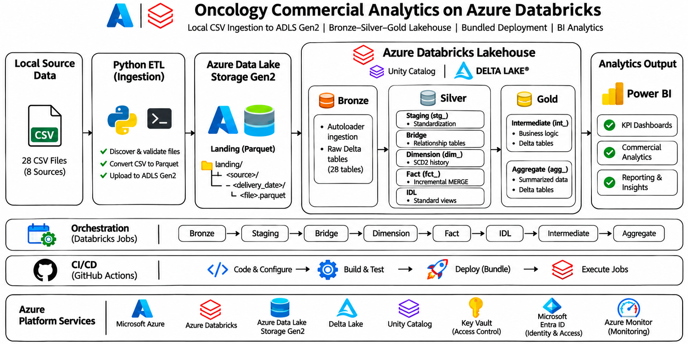

# Oncology Commercial Analytics | Azure Databricks Lakehouse

An end-to-end **Azure Data Engineering project** implementing a Medallion Lakehouse architecture for oncology commercial analytics.

Built with **Azure Data Lake Storage Gen2, Azure Databricks, Auto Loader, Delta Lake, Unity Catalog, PySpark, Spark SQL, and Databricks Jobs**, the project supports ingestion, transformation, incremental processing, and analytical reporting—without Airflow, Snowflake, or dbt.



## Architecture

```text
Local CSV Files (8 Sources / 28 Datasets)
                │
                ▼
Python Ingestion (CSV → Parquet)
                │
                ▼
Azure Data Lake Storage Gen2
                │
                ▼
Databricks Auto Loader
                │
                ▼
BRONZE (Raw Delta Tables)
                │
                ▼
SILVER
Staging → Bridges → Dimensions → Facts → IDL
                │
                ▼
GOLD
Intermediate KPIs → Aggregates
                │
                ▼
Power BI / Commercial Analytics
```

**Unity Catalog:** `onco_pharma_analytics`

## Data Sources

The project integrates **28 datasets across 8 source domains**.

| Source | Datasets | Business Domain |
|---|---:|---|
| Veeva CRM | 7 | HCP interactions and CRM activity |
| Veeva Align | 2 | Territory and field-force alignment |
| IQVIA DDD / Xponent | 2 | Distribution and prescription analytics |
| IQVIA OneKey | 4 | HCP/HCO master data and affiliations |
| Internal MDM | 4 | Internal reference and targeting data |
| Product MDM | 7 | Product, brand and indication reference data |
| Hub | 1 | Patient support transactions |
| Specialty Pharmacy | 1 | Dispensing and shipment data |
| **Total** | **28** | |

## Technology Stack

| Category | Technologies |
|---|---|
| Cloud Platform | Microsoft Azure |
| Data Storage | ADLS Gen2, Delta Lake |
| Data Processing | Azure Databricks, Apache Spark |
| Languages | Python 3.12, PySpark, Spark SQL |
| Data Ingestion | Azure SDK, pandas, PyArrow, Auto Loader |
| Governance | Unity Catalog |
| Orchestration | Databricks Jobs |
| Deployment | Databricks Asset Bundles, Databricks CLI |
| Development | uv, Azure CLI, Git, GitHub |
| Reporting Target | Power BI |

## Repository Structure

```text
.
├── 01_data_ingestion/
│   ├── main.py
│   ├── check_connection.py
│   ├── discover_files.py
│   └── local_to_adls.py
│
├── 02_data_transformation/
│   └── azure_databricks/
│       ├── README.md
│       ├── databricks.yml
│       ├── resources/          # Databricks Jobs
│       ├── bronze/             # Auto Loader
│       ├── config/             # Staging configurations
│       ├── silver/             # Staging, bridges, dims, facts, IDL
│       ├── gold/               # KPIs and aggregates
│       └── utils/
│
├── utils/                     # Configuration and logging
├── docs/
│   └── architecture.png
├── .env.example
├── .gitignore
├── pyproject.toml
└── uv.lock
```

## Lakehouse Processing

| Layer | Models | Implementation |
|---|---:|---|
| Landing | 28 datasets | CSV → Parquet, SHA-256-based naming, ADLS upload |
| Bronze | 28 source tables (target) | Auto Loader, raw Delta ingestion |
| Silver Staging | 28 | Config-driven PySpark standardization |
| Silver Bridges | 3 | Entity relationship mapping |
| Silver Dimensions | 17 | Conformed dimensions and SCD Type 2 |
| Silver Facts | 12 | Incremental Delta MERGE |
| Silver IDL | 7 | Integrated analytical datasets |
| Gold Intermediate | 10 | HCP, patient and product KPIs |
| Gold Aggregates | 5 | Business-ready reporting marts |

**Processing capabilities:**
- **Incremental ingestion:** Auto Loader discovers new files using persistent checkpoints.
- **Data standardization:** Reusable PySpark transformations configured through JSON.
- **Historical tracking:** SCD Type 2 patterns for selected dimensions and bridges.
- **Incremental facts:** Delta MERGE handles new and updated source records.
- **Orchestration:** Dependency-controlled layer execution using Databricks Jobs.
- **Analytics:** Gold datasets designed for BI and commercial reporting.

## Getting Started

### 1. Prerequisites

- Python 3.12+, [uv](https://docs.astral.sh/uv/), Azure CLI
- Azure subscription with ADLS Gen2 storage
- Azure Databricks workspace with Unity Catalog
- Appropriate storage, catalog and job permissions

### 2. Configure Azure Authentication

```bash
az login
az account set --subscription <subscription-id>
```

The ingestion utility authenticates through `AzureCliCredential`.

Copy `.env.example` to `.env` and configure the storage endpoint, filesystem and local `SOURCE_DATA_DIR`.

### 3. Run Data Ingestion

```bash
uv sync
uv run python 01_data_ingestion/main.py
```

The pipeline discovers local CSVs, converts them to Parquet and uploads them to ADLS Gen2.

**Landing structure:**

```text
<source>/<table>/<UTC-delivery-date>/<filename>_<hash>.parquet
```

File-level logging tracks uploaded, skipped and failed files in `logs/pipeline.log`. Same-day duplicate content with the same source filename is skipped; this is not a global cross-date deduplication mechanism.

### 4. Deploy Databricks Pipeline

```bash
cd 02_data_transformation/azure_databricks

databricks bundle validate -t dev
databricks bundle deploy -t dev
databricks bundle run main_pipeline_job -t dev
```

**Execution sequence:**

```text
Bronze → Staging → Bridges → Dimensions
       → Facts → IDL → Intermediate KPIs → Aggregates
```

The main job coordinates eight Databricks layer jobs through dependency-based execution.

See the [Azure Databricks README](02_data_transformation/azure_databricks/README.md) for detailed configuration and deployment requirements.

## Data Quality & Reliability

The architecture incorporates file-level ingestion logging, Auto Loader checkpointing, reusable transformation logic, incremental MERGE patterns, SCD2 history and job dependency gates.

Recommended validations include source-to-target reconciliation, required-key checks, duplicate detection, SCD2 validity checks, fact integrity and KPI consistency.

A complete automated test suite is not yet included.

## Security & Version Control

Sensitive and environment-specific files should remain outside Git:

- `.env`, credentials, tokens and local configuration secrets
- `.venv/`, logs, local CSV/Parquet datasets and `source_data/`
- Databricks bundle state, checkpoints and generated notebook outputs

Use `.env.example` for safe configuration sharing. Maintain one root Git repository unless separate repositories are intentional. Never publish actual patient or commercially sensitive records without authorization.

## Project Status

**Status: Under Active Development**

The repository includes the local ingestion implementation, transformation models and Databricks orchestration definitions. Successful end-to-end execution has not yet been independently verified.

**Remaining work:** Resolve bundle notebook-path mismatches, validate Unity Catalog and ADLS permissions, implement automated testing, configure CI/CD and production deployment, and connect reporting assets.

This project demonstrates a **Databricks-native oncology analytics lakehouse architecture** designed for scalable data engineering and downstream commercial intelligence.

---

**Detailed Documentation:** [Azure Databricks Transformation](02_data_transformation/azure_databricks/README.md)
